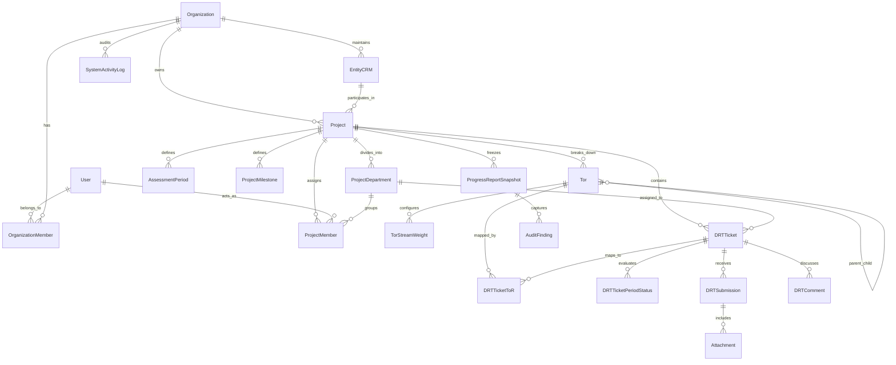

# Zio Tech GRC: Architecture & Technical Specification

## 1. Executive Summary & Release Scope
- **Product Name:** Zio Tech GRC
- **Primary Mission:** Multi-tenant SaaS platform built to digitize, automate, and orchestrate Information Systems (IS) and regulatory compliance audits.
- **Pilot Target:** Full end-to-end execution of the Bangladesh Telecommunication Regulatory Commission (BTRC) & Fiber@Home Limited (FHL) IS Audit (2009–2024).
- **Phasing Strategy:** Multi-tenant isolation architecture established on Day 1. SaaS billing (Stripe) deferred post-pilot. Pilot data onboarding supported via a dedicated Excel import wizard.

---

## 2. Technical Stack Architecture
- **Repository Structure:** Monorepo (`/backend` + `/frontend`).
- **Backend Service:** Express.js (TypeScript, layered modular architecture: routes, controllers, services, middlewares).
- **ORM & Data Layer:** Prisma ORM connected to Neon DB (Serverless PostgreSQL with connection pooling).
- **Frontend Application:** Next.js 16 (App Router, React 19, TypeScript), Tailwind CSS v4, Base UI / shadcn/ui component kit, TanStack Query (REST with query invalidation/polling).
- **Object Storage:** Cloudflare R2 (S3-compatible, private bucket, presigned upload/download URLs, SHA-256 integrity checksums).
- **Authentication:** Custom JWT-based authentication in Express (short-lived access tokens, httpOnly refresh cookie, argon2 password hashing). Supports invitation links + direct creation with temporary credentials by Org Admins.

---

## 3. Core Domain Entities & Relational Blueprint

### 3.1. Identity & Tenancy
1. **User:** Global identity (`id`, `email` [unique], `passwordHash`, `name`, `phone`, `nid`, `isSuperAdmin`, `isActive`).
2. **Organization:** Tenant boundary (`id`, `orgName`, `orgType`, `contactInfo`, `createdBy`).
3. **OrganizationMember:** Tenant staff roles (`id`, `orgId`, `userId`, `orgRole` [`OWNER`, `ADMIN`, `AUDITOR`]).

### 3.2. Project & 4-Team Collaboration
1. **EntityCRM:** Reusable corporate profile directory (`id`, `orgId`, `name`, `type` [`CLIENT`, `AUDITEE`], `address`, `contactDetails`).
2. **Project:** Audit workspace (`id`, `orgId`, `clientId`, `auditeeId`, `projectName`, `startDate`, `endDate`, `status` [`DRAFT`, `ACTIVE`, `COMPLETED`], `isDeleted`).
3. **ProjectDepartment:** Subdivisions under Client Team 2 (`id`, `projectId`, `name` e.g., Marketing, Sales, IT, Legal, Engineering).
4. **ProjectMember:** 
   - `id`, `projectId`, `userId`
   - `teamBucket`: [`ORG_TEAM_1`, `ORG_TEAM_2`, `CLIENT_TEAM_1`, `CLIENT_TEAM_2`]
   - `departmentId`: Nullable, links Client Team 2 members to their functional unit.

### 3.3. Work Breakdown Structure (ToR) & Data Request Tracking (DRT)
1. **Tor:** Infinite hierarchical tree (`id`, `projectId`, `parentId` [nullable], `code` e.g. "1.2.1", `title`, `description`, `sortOrder`).
2. **DRTTicket:** 
   - `id`, `projectId`, `requestCode` (e.g., "M1001", unique per project)
   - `assignedTeamBucket`: [`CLIENT_TEAM_1`, `CLIENT_TEAM_2`]
   - `departmentId`: Nullable (routes tickets directly to specific functional units)
   - `description`, `dateOfRequest`, `expectedDateOfReceipt`, `actualDateOfReceipt`
   - `lifecycleStatus`: [`OPEN`, `SUBMITTED`, `REVISION_REQUESTED`, `ACCEPTED`]
   - `reviewStatus`: [`PENDING`, `PARTIAL`, `DONE`, `NOT_AVAILABLE`, `NOT_APPLICABLE`]
   - `excessDays`: Automatically calculated derived integer.
3. **DRTTicketToR:** Junction table (`id`, `ticketId`, `torId`) enabling many-to-many relationships.

### 3.4. Mathematical Engine & Weighted Scoring
1. **AssessmentPeriod:** For multi-year audits (`id`, `projectId`, `periodKey` e.g., "2024", `weight` float normalised to 100%, `revenueAmount` optional float).
2. **DRTTicketPeriodStatus:** Grid entry for year-wise audits (`id`, `ticketId`, `periodId`, `status` [`SHARED`, `PARTIAL`, `NOT_SHARED`, `NOT_APPLICABLE`]).
3. **ProjectMilestone:** High-level project phases (`id`, `projectId`, `name` e.g. "Kick-off Meeting", `allocatedMarks`, `isCompleted`).
4. **TorStreamWeight:** Stream-specific weights on ToR nodes (`id`, `torId`, `teamStream` [`CLIENT_TEAM_1`, `CLIENT_TEAM_2`], `dataCollectionMarks`, `dataAnalysisAllocatedMarks`, `dataAnalysisObtainedMarks`).

### 3.5. Evidence, Progress Freezing & Compliance Auditing
1. **DRTSubmission:** Evidence packages submitted by client users (`id`, `ticketId`, `submittedById`, `comments`, `version`).
2. **Attachment:** Polymorphic Cloudflare R2 files (`id`, `recordType`, `recordId`, `r2Key`, `fileName`, `fileSizeBytes`, `mimeType`, `sha256Hash`, `uploadedById`).
3. **DRTComment:** Contextual communication threads (`id`, `ticketId`, `userId`, `message`, `isInternalOnly`).
4. **ProgressReportSnapshot:** Immutable checkpoint (`id`, `projectId`, `reportNumber`, `reportName`, `frozenAt`, `scorePayload` JSON).
5. **AuditFinding:** Structured observations linked to snapshots (`id`, `snapshotId`, `torId`, `findingCode`, `title`, `details`, `severity`).
6. **SystemActivityLog:** Tamper-evident hash-chained audit log (`id`, `orgId`, `projectId`, `actorId`, `entityType`, `entityId`, `action`, `diffPayload` JSON, `ipAddress`, `previousHash`, `currentHash`).

---

## 4. RBAC & Data Visibility Matrix

| Role / Team Bucket | View Scope | Action Permissions |
| :--- | :--- | :--- |
| **Org Owner / Admin** | Complete tenant (all projects, streams, logs, financial variables) | Full CRUD, configuration, snapshot freezing, user management |
| **Lead Auditor / Org Team 1** | Full project read; primary focus on Client Team 1 (Regulator) | Ticket generation, review status marking, analysis score input |
| **Org Team 2** | Full project read; primary focus on Client Team 2 (Auditee) | Ticket generation, review status marking, analysis score input |
| **Client Team 1 (Regulator)** | Read-only oversight of all tickets, dashboards, and macro scores | View all progress, upload documents for own tickets |
| **Client Team 2 (Auditee Dept)** | Scoped to assigned department's DRT tickets & stream dashboard | Upload evidence, reply to comments, view own submission SLA |

---

## 5. Implementation Roadmap

### Phase 1: Foundation & Backend Scaffold
- Scaffolding `/backend` with Express.js, TypeScript, and Prisma.
- Prisma ORM initialization with complete schema definition matching the blueprint.
- Neon DB (Serverless PostgreSQL) setup, connection pooling configuration (`DATABASE_URL` / `DIRECT_URL`), and baseline migrations.
- Identity & Auth Module (JWT, argon2, rotating refresh cookie via `cookie-parser`, authentication middleware, user creation & invitation endpoints).

### Phase 2: Core Domain & Organization Isolation
- `tenantMiddleware` and role-based guards ensuring strict `orgId` isolation.
- Organizations, Members, and EntityCRM CRUD modules.
- Project instantiation wizard endpoints supporting 4-team member assignment & departments.

### Phase 3: WBS (ToR) & DRT Engine
- ToR Tree module with recursive queries and nested branch management.
- DRT Ticket module: human-readable request codes, department routing, many-to-many ToR mapping.
- DRT Submission & Commenting system with Cloudflare R2 presigned upload pipeline.

### Phase 4: Mathematical Scoring Engine & Snapshots
- Calculation Service: real-time recalculation of baseline marks, status factors, and year-wise revenue weights.
- Project Milestones & Data Analysis score management.
- Progress Report Snapshot engine with finding records and report comparison deltas.

### Phase 5: Excel Import/Export & Activity Logging
- Hash-chained immutable `SystemActivityLog` service and audit middleware.
- Pilot Excel Onboarding Wizard (parsing FHL/BTRC workbook sheets to seed ToR, DRTs, and historical weights).
- Excel/PDF report export services.

### Phase 6: Frontend Integration & Polish
- Monorepo alignment and TanStack Query integration in `/frontend`.
- Dynamic Tree UI, Kanban / Data Table hybrid for DRT tickets.
- Real-time scoring dashboards, departmental drill-downs, and client upload portal.
