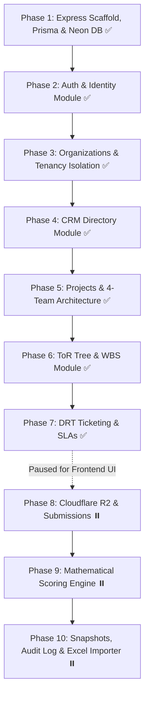

# Granular Backend Implementation Plan (Express + Prisma + Neon DB)

## Overview & Approach
To ensure complete transparency, traceability, and high code quality, backend development is structured into **10 granular, sequential phases**. Each phase is broken down into small, isolated tasks using **Express.js**, **Prisma ORM**, and **Neon DB** (Serverless PostgreSQL).

> [!NOTE]
> **Backend Development Status (as of 2026-10-12):**
> **Phases 1 through 7 are 100% complete and fully verified** with comprehensive test suites, clean TypeScript builds, and atomic Git commits.
> Backend development is currently paused to build the complete frontend App Router interface on top of the live APIs.
> **Remaining backend phases (Phase 8: R2 Storage & Submissions, Phase 9: Real-time Scoring Engine, Phase 10: Snapshots & Excel Migration) will resume immediately after the frontend milestone.**

---

## Phase Status Summary

| Phase | Module | Status | Commit / Notes |
| :--- | :--- | :---: | :--- |
| **Phase 1** | Express Hybrid Scaffold, Prisma & Neon DB | **COMPLETED** | `91c6fe2` — Hybrid server setup, Prisma singleton, health check |
| **Phase 2** | Authentication & Identity (`/api/v1/auth`, `/api/v1/users`) | **COMPLETED** | `893eb27`..`f7797ad` — Argon2id, JWT, refresh rotation, user directory |
| **Phase 3** | Organizations & Tenant Boundary (`/api/v1/organizations`) | **COMPLETED** | `1c7e616`, `c887da6`, `40f0058` — Multi-tenant isolation, RBAC, member management |
| **Phase 4** | CRM Directory Module (`/api/v1/crm`) | **COMPLETED** | `e0d6d29`, `bb7af50` — Client (BTRC) & Auditee (Fiber@Home) directory CRUD |
| **Phase 5** | Projects & 4-Team Architecture (`/api/v1/projects`) | **COMPLETED** | `da35e57`, `070a686`, `ac8e4c1` — Project workspace, departments, 4-team collaborative buckets |
| **Phase 6** | Terms of Reference (ToR) WBS Tree (`/api/v1/tors`) | **COMPLETED** | `fe5a433`, `d2c06b5` — Hierarchical WBS tree, recursive builder, stream weights |
| **Phase 7** | Data Request Tracking (DRT) Engine (`/api/v1/drt`) | **COMPLETED** | `88d8a88`, `57a02e6` — Ticketing, ToR mapping, 2-tier status, automated SLA delay, period grid |
| **Phase 8** | Cloudflare R2 Storage & Evidence Submissions | *PAUSED* | Presigned uploads, evidence packages, comments |
| **Phase 9** | Real-time Mathematical Scoring Engine | *PAUSED* | Revenue-weighted formulas, milestone marks, macro scoring |
| **Phase 10** | Snapshots, Tamper-Evident Audit Log & Excel Importer | *PAUSED* | Immutable frozen snapshots, SHA-256 chained audit logs, Excel import wizard |

---

## Architecture Flow

---

### Phase 1: Database Foundation & Prisma + Neon DB Setup
*Objective:* Scaffold Express.js backend, connect to Neon DB via Prisma ORM, and establish base validation & configuration.
- **Task 1.1:** Initialize the `/backend` directory with Express.js, TypeScript, and developer tooling (`tsx`/`ts-node-dev`, `dotenv`, `cors`, `helmet`, `cookie-parser`).
- **Task 1.2:** Initialize Prisma ORM, configure `schema.prisma` for Neon DB (`DATABASE_URL` with connection pooling and `DIRECT_URL`), and create the singleton `prisma` client.
- **Task 1.3:** Setup reusable Zod validation middleware (`validateBody`, `validateQuery`, `validateParams`) and centralized Express `errorHandler` middleware.
- **Task 1.4:** Test database handshake on application boot (`GET /api/v1/health`).
- *Checkpoint:* Git commit & push: `feat(db): establish Express scaffold, Prisma ORM, and Neon DB connection`.

---

### Phase 2: Authentication & Identity Module (`/api/v1/auth`)
*Objective:* User management, JWT token generation, password hashing, and role middleware.
- **Task 2.1:** Implement `User` model in `schema.prisma` and run baseline migration on Neon DB.
- **Task 2.2:** Build `argon2` password hashing utility service.
- **Task 2.3:** Implement `POST /api/v1/auth/register` (initial organization owner) with Zod request validation.
- **Task 2.4:** Implement `POST /api/v1/auth/login` (JWT access token in header + rotating refresh token in `httpOnly` cookie).
- **Task 2.5:** Implement `POST /api/v1/auth/refresh` & `GET /api/v1/auth/me` with `authenticate` JWT middleware.
- **Task 2.6:** Implement `POST /api/v1/auth/create-user` (Org Admin direct provisioning with email & temporary password).
- *Checkpoint:* Verify auth tests $\rightarrow$ Git commit & push: `feat(auth): user authentication, argon2 hashing, and JWT session management`.

---

### Phase 3: Organizations & Tenant Boundary (`/api/v1/organizations`)
*Objective:* Multi-tenant boundaries and staff RBAC.
- **Task 3.1:** Implement `Organization` and `OrganizationMember` models in Prisma (`OWNER`, `ADMIN`, `AUDITOR`).
- **Task 3.2:** Build `POST /api/v1/organizations` & `GET /api/v1/organizations/:id` (scoped to authenticated user).
- **Task 3.3:** Build `tenantMiddleware` and `requireOrgRole` middleware to enforce strict `orgId` isolation.
- **Task 3.4:** Build member management endpoints: `GET /api/v1/organizations/:id/members`, `PATCH /api/v1/organizations/:id/members/:memberId`, `DELETE /api/v1/organizations/:id/members/:memberId`.
- *Checkpoint:* Verify tenant isolation tests $\rightarrow$ Git commit & push: `feat(orgs): multi-tenant organization boundary and member RBAC`.

---

### Phase 4: CRM Directory Module (`/api/v1/crm`)
*Objective:* Centralized, reusable Client and Auditee corporate entities.
- **Task 4.1:** Implement `EntityCRM` model in Prisma (`CLIENT`, `AUDITEE`, corporate contact details).
- **Task 4.2:** Build `POST /api/v1/crm/entities` and `GET /api/v1/crm/entities` (paginated & searchable, isolated by `orgId`).
- **Task 4.3:** Build `PATCH /api/v1/crm/entities/:id` and `DELETE /api/v1/crm/entities/:id`.
- *Checkpoint:* Unit tests $\rightarrow$ Git commit & push: `feat(crm): client and auditee reusable entity directory`.

---

### Phase 5: Projects & 4-Team Architecture (`/api/v1/projects`)
*Objective:* Audit project workspace, 4-team collaborative buckets, and Auditee departments.
- **Task 5.1:** Implement `Project`, `ProjectDepartment`, and `ProjectMember` models in Prisma.
- **Task 5.2:** Build `POST /api/v1/projects` (linking Client & Auditee CRM) and `GET /api/v1/projects/:id`.
- **Task 5.3:** Build `POST /api/v1/projects/:id/departments` & `GET /api/v1/projects/:id/departments` (Marketing, Sales, IT, Legal, Engineering).
- **Task 5.4:** Build `POST /api/v1/projects/:id/members/batch` assigning users into 4 team buckets:
  - `ORG_TEAM_1` $\leftrightarrow$ `CLIENT_TEAM_1` (Regulator)
  - `ORG_TEAM_2` $\leftrightarrow$ `CLIENT_TEAM_2` (Auditee, linked to `departmentId`).
- *Checkpoint:* Test 4-team mapping $\rightarrow$ Git commit & push: `feat(projects): project lifecycle, departments, and 4-team collaborative buckets`.

---

### Phase 6: Terms of Reference (ToR) WBS Tree (`/api/v1/tors`)
*Objective:* Hierarchical tree execution with stream weight distribution.
- **Task 6.1:** Implement `Tor` (self-referencing hierarchy) and `TorStreamWeight` models in Prisma.
- **Task 6.2:** Build `POST /api/v1/projects/:projectId/tors` (parent-child linking, sorting, baseline codes e.g. "1.1.2").
- **Task 6.3:** Build `GET /api/v1/projects/:projectId/tors/tree` (recursive tree retrieval service).
- **Task 6.4:** Build `POST /api/v1/tors/:id/stream-weights` (Data Collection marks vs. Data Analysis marks for Client Team 1 and 2).
- *Checkpoint:* Test tree operations $\rightarrow$ Git commit & push: `feat(tors): hierarchical WBS tree and stream weight allocation`.

---

### Phase 7: Data Request Tracking (DRT) Engine (`/api/v1/drt`)
*Objective:* Ticketing engine, many-to-many ToR mapping, department routing, SLA delays.
- **Task 7.1:** Implement `DRTTicket`, `DRTTicketToR`, and `DRTTicketPeriodStatus` models in Prisma.
- **Task 7.2:** Build `POST /api/v1/projects/:projectId/drt-tickets` (human-readable codes like `M1001`, expected receipt date).
- **Task 7.3:** Build many-to-many ToR mapping endpoint (`POST /api/v1/drt-tickets/:id/tor-mappings`).
- **Task 7.4:** Build `PATCH /api/v1/drt-tickets/:id/lifecycle` (`OPEN` $\rightarrow$ `SUBMITTED` $\rightarrow$ `REVISION_REQUESTED` $\rightarrow$ `ACCEPTED`).
- **Task 7.5:** Build `PATCH /api/v1/drt-tickets/:id/review-status` (auditor-only: `DONE`, `PARTIAL`, `PENDING`, `NOT_AVAILABLE`, `NOT_APPLICABLE`), with automated `excessDays` calculation.
- *Checkpoint:* Test SLA logic & review outcomes $\rightarrow$ Git commit & push: `feat(drt): DRT ticketing engine, department routing, and SLA tracking`.

---

### Phase 8: Cloudflare R2 Storage & Evidence Submissions (`/api/v1/storage`, `/api/v1/submissions`)
*Objective:* Private evidence file management and in-ticket communication.
- **Task 8.1:** Implement `Attachment`, `DRTSubmission`, and `DRTComment` models in Prisma.
- **Task 8.2:** Build Cloudflare R2 presigned upload URL generator with MIME & size validation (`POST /api/v1/storage/presigned-upload`).
- **Task 8.3:** Build `POST /api/v1/drt-tickets/:id/submissions` (versioned packages linking uploaded R2 attachments).
- **Task 8.4:** Build `POST /api/v1/drt-tickets/:id/comments` (supporting `isInternalOnly` auditor note privacy flag).
- *Checkpoint:* Test R2 presigned URLs & comment privacy $\rightarrow$ Git commit & push: `feat(storage): Cloudflare R2 evidence storage and ticket discussions`.

---

### Phase 9: Real-time Mathematical Scoring Engine (`/api/v1/scoring`)
*Objective:* Multi-year revenue weighting, milestone marks, and ToR score rollups.
- **Task 9.1:** Implement `AssessmentPeriod` and `ProjectMilestone` models in Prisma.
- **Task 9.2:** Build revenue-normalized assessment period configuration (`POST /api/v1/projects/:projectId/assessment-periods`).
- **Task 9.3:** Build live calculation engine service:
  $$Score_{DRT} = AllocatedMark \times \sum(PeriodWeight_i \times StatusFactor_i)$$
  $$Score_{ToR} = \sum Score_{DRT} + DataAnalysisMark$$
- **Task 9.4:** Build macro dashboard endpoint (`GET /api/v1/projects/:projectId/scores/summary`) and departmental breakdown endpoint.
- *Checkpoint:* Test calculations against Excel test cases $\rightarrow$ Git commit & push: `feat(scoring): mathematical scoring engine and multi-year weighting`.

---

### Phase 10: Snapshots, Tamper-Evident Audit Log & Migration Wizard (`/api/v1/snapshots`, `/api/v1/activity-log`, `/api/v1/migration`)
*Objective:* Immutable report checkpoints, cryptographic audit logging, and pilot Excel data ingestion.
- **Task 10.1:** Implement `ProgressReportSnapshot` & `AuditFinding` models in Prisma with freeze and delta ($\Delta$) comparison endpoints.
- **Task 10.2:** Implement SHA-256 hash-chained `SystemActivityLog` service and audit logging middleware.
- **Task 10.3:** Build Excel migration endpoint (`POST /api/v1/migration/import-pilot-excel`) to parse and seed the FHL/BTRC workbook into live records.
- *Checkpoint:* Test snapshot deltas & Excel ingestion $\rightarrow$ Git commit & push: `feat(audit): report snapshots, hash-chained activity log, and pilot Excel import`.
