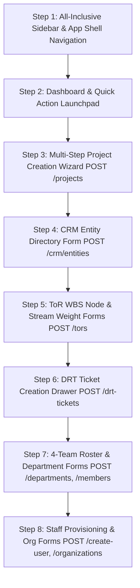

# Workflow & Form-First Frontend Implementation Plan (RTK Query + TanStack Form + Next.js 16)

## 1. Objective & Strategic Focus

Our immediate goal is to establish the complete end-to-end **interactive workflow** of the Zio Tech GRC SaaS platform:
1. **Comprehensive Navigation:** Build an all-inclusive Sidebar containing every major module and workflow page in the system.
2. **Page Scaffolding & Visual Clarity:** Every route provides a clear heading, breadcrumb, contextual description, and high-visibility action buttons.
3. **Form-First Architecture (All POST APIs):** Build and connect all data-entry forms to their live backend `POST` API mutations using **TanStack Form** and **RTK Query**.
4. **Multi-Step Wizards:** For complex workflows with multiple inputs (e.g. Audit Project Creation), structure the form into guided multi-step wizards with validation gates.
5. **Custom Modals & Drawers (Zero shadcn/Radix modal libraries):** Use our bespoke pure React `Modal` (`src/components/ui/Modal.tsx`) and slide-over `Drawer` (`src/components/ui/Drawer.tsx`) with dark frosted backdrop blur (`backdrop-blur-sm`), keyboard `Escape` handling, and fluid entrance animations.
6. **Workflow Over Dense Data:** Postpone complex data tables and analytics until all operational flows, tenant boundaries, and submission pipelines are fully functional and verifiable.

---

## 2. All-Inclusive Sidebar Navigation Blueprint

The Sidebar will house all core modules categorized by operational domain:

| Menu Item | Route | Domain & Purpose | Primary POST API / Action |
| :--- | :--- | :--- | :--- |
| **Dashboard** | `/dashboard` | Operational overview & quick launchpad | Quick Action Triggers |
| **Audit Projects** | `/projects` | Audit engagement workspaces (BTRC & FHL) | `POST /api/v1/projects` (Multi-Step Custom Modal) |
| **CRM Directory** | `/crm/entities` | Corporate directory (Regulator / Auditee) | `POST /api/v1/crm/entities` (Custom Modal Form) |
| **ToR Management** | `/tors` | Hierarchical Terms of Reference (WBS) | `POST /api/v1/projects/:id/tors` & Stream Weights |
| **DRT Requests** | `/drt` | Data Request Tracking ticketing hub | `POST /api/v1/projects/:id/drt-tickets` (Custom Drawer) |
| **4-Team Roster** | `/team` | Collaborative boundaries (`ORG_1,2` $\leftrightarrow$ `CLIENT_1,2`) | `POST /api/v1/projects/:id/members/batch` |
| **Departments** | `/departments` | Auditee operational units (IT, Legal, etc.) | `POST /api/v1/projects/:id/departments` |
| **Staff & Members** | `/organization/members` | User administration & tenant RBAC | `POST /api/v1/auth/create-user` (Custom Modal) |
| **Organization** | `/organization/settings` | Tenant profile & organization management | `POST /api/v1/organizations` (Custom Modal) |
| **My Profile** | `/settings/profile` | Personal credentials & preferences | `PATCH /api/v1/users/me` |

---

## 3. Phased Form-First Execution Steps

---

### Step 1: All-Inclusive Sidebar & App Shell Navigation
- Update `src/components/layout/Sidebar.tsx` with all 10 navigation routes organized into clean sections:
  - **Audit Workspaces:** Dashboard, Audit Projects, CRM Directory.
  - **Compliance Engine:** ToR Management (WBS), DRT Requests, 4-Team Roster, Departments.
  - **Administration:** Staff & Members, Organization Settings, My Profile.
- Connect tenant switcher and active user session badge.
- *Verification:* All sidebar links render and transition cleanly.

---

### Step 2: Dashboard Overview & Quick Action Launchpad (`/dashboard`)
- Page header: "Executive GRC Overview" with active tenant context badge.
- Summary metric cards (Total Engagements, Pending DRT Requests, BTRC Milestones, Auditee SLAs).
- Quick Action buttons launching key forms directly:
  - `+ New Project Wizard`
  - `+ New DRT Request`
  - `+ Add Corporate Entity`
  - `+ Provision Staff Member`

---

### Step 3: Audit Projects Page & Multi-Step Creation Wizard (`/projects`)
- Page header: "Audit Project Workspaces" with `+ New Project` button.
- Multi-step wizard inside our custom `Modal` built with **TanStack Form**:
  - **Step 1 — Project Scope:** Title (e.g., "BTRC & Fiber@Home IS Audit 2009–2024"), description, audit start/end dates.
  - **Step 2 — Corporate Entities:** Select Client (Regulator/BTRC) and Auditee (Fiber@Home) from CRM.
  - **Step 3 — Department Baseline:** Toggle standard departments (Engineering, IT, Marketing, Sales, Legal, Finance).
- Submits to `POST /api/v1/projects` and batch seeds departments.

---

### Step 4: CRM Directory Page & Entity Creation Form (`/crm/entities`)
- Page header: "Corporate Entity Directory" with `+ Add Entity` button.
- Custom `Modal` Form built with **TanStack Form**:
  - Entity Name (e.g. "Bangladesh Telecommunication Regulatory Commission").
  - Short Code (e.g. "BTRC", "FHL").
  - Entity Type: Radio/Select `CLIENT` (Regulator) vs `AUDITEE` (Audited Entity).
  - Corporate Contact: Contact person, official email, phone, physical address.
- Submits to `POST /api/v1/crm/entities`.

---

### Step 5: Terms of Reference (ToR WBS) & Stream Weight Forms (`/tors`)
- Page header: "Terms of Reference (WBS) Management" with project selector and `+ Add ToR Node` button.
- Custom `Modal` for ToR Node Creation:
  - Code (e.g. "1.1.2"), Title, Description, Allocated Marks, Parent Node selector.
  - Submits to `POST /api/v1/projects/:id/tors`.
- Custom `Modal` for Stream Weight Allocation:
  - Visual mark divider: Data Collection marks vs Data Analysis marks for Client Team 1 and 2.
  - Submits to `POST /api/v1/tors/:id/stream-weights`.

---

### Step 6: Data Request Tracking (DRT Hub) & Ticket Creation Drawer (`/drt`)
- Page header: "Data Request Tracking (DRT) Engine" with `+ New DRT Request` button.
- Slide-over custom `Drawer` built with **TanStack Form**:
  - Ticket Code (e.g. `M1001`), Request Title, Description.
  - Recipient Auditee Department selector (Marketing, IT, Legal, etc.).
  - Expected Date of Receipt (SLA deadline).
  - Multi-select ToR association picker (`DRTTicketToR`).
  - Priority selector (Low, Medium, High, Critical).
- Submits to `POST /api/v1/projects/:id/drt-tickets`.

---

### Step 7: 4-Team Roster & Department Routing Forms (`/team`, `/departments`)
- **Departments Page (`/departments`):**
  - Header with `+ Add Department` button.
  - Custom `Modal` Form: Department Name, Code, Description.
  - Submits to `POST /api/v1/projects/:id/departments`.
- **4-Team Collaborative Roster (`/team`):**
  - Header with `+ Assign Member` button.
  - Custom `Modal` Form: Select User, Collaborative Bucket (`ORG_TEAM_1`, `ORG_TEAM_2`, `CLIENT_TEAM_1`, `CLIENT_TEAM_2`), and Department mapping.
  - Submits to `POST /api/v1/projects/:id/members/batch`.

---

### Step 8: Staff Provisioning & Organization Management Forms (`/organization/*`)
- **Staff & Members (`/organization/members`):**
  - Header with `+ Provision / Invite Staff` button.
  - Custom `Modal` Form: Full Name, Email, Temporary Password, Organization Role (`ADMIN`, `AUDITOR`, `MEMBER`).
  - Submits to `POST /api/v1/auth/create-user`.
- **Organization Settings (`/organization/settings`):**
  - Header with `+ Create New Organization` button.
  - Custom `Modal` Form: Organization Name, Type, Address, Phone, Website.
  - Submits to `POST /api/v1/organizations`.

---

## 4. Sub-task Execution Rules
- Work strictly one sub-task at a time.
- Verify every sub-task with `pnpm typecheck` and `npx next build`.
- Mandatory pause for review before git commit.
- Advance only upon explicit user approval ("review is good").
