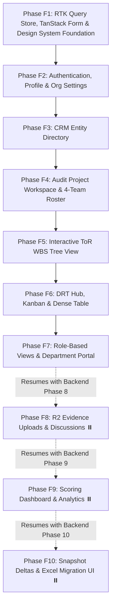

# Frontend Implementation Plan (Next.js 16 App Router + React 19 + RTK Query + TanStack Form + Tailwind CSS v4)

## 1. Overview & Architecture Alignment

This document outlines the end-to-end frontend architecture and phased execution plan for **Zio Tech GRC**. The frontend operates as a unified Next.js 16 App Router application served seamlessly alongside the Express.js `/api/v1/*` backend via `server/index.ts`.

> [!NOTE]
> **Backend & Frontend Roadmap Synchronization:**
> - **Backend Phases 1 through 7 are 100% completed and verified** (Scaffold, Neon DB, Auth, Organizations, CRM Directory, Projects & 4-Team Roster, ToR WBS Tree, DRT Ticketing Engine).
> - Backend Phases 8–10 (Cloudflare R2 Evidence Storage, Mathematical Scoring Engine, Snapshots/Excel Import) are **paused** to enable full UI development on top of the live APIs.
> - The complete backend status is tracked in [Docs/backend_implementation_plan.md](file:///c:/Users/ADMIN/Desktop/Zio%20Tech%20GRC/Docs/backend_implementation_plan.md).
> - This frontend plan focuses on consuming the 7 active backend modules first (**Phases F1–F6**), followed by role portals (**Phase F7**), and aligns with future backend resumption (**Phases F8–F10**).

---

## 2. Technical Stack & Frontend Architecture

- **Framework:** Next.js 16 (App Router, React 19, TypeScript).
- **State Management & Data Layer:** **Redux Toolkit (RTK Query)** (`@reduxjs/toolkit`, `react-redux`)
  - Normalized cache management, polling/refetching on focus, and declarative cache tags (`Auth`, `Organization`, `CRM`, `Project`, `ToR`, `DRT`).
  - Centralized base API (`src/store/api/baseApi.ts`) with custom `fetchBaseQuery` handling Bearer token injection and seamless 401 refresh token rotation via `/api/v1/auth/refresh`.
  - Global UI & auth slices (`authSlice`, `uiSlice`) for active tenant, active team bucket, and notification state.
- **Form Management:** **TanStack Form** (`@tanstack/react-form`)
  - Type-safe, fine-grained reactive form states with zero unnecessary component re-renders.
  - Paired with **Zod** schema validators for synchronized frontend/backend contract validation across complex multi-step wizards, slide-over drawers, and inline weight editors.
- **Styling & Design System:** **Tailwind CSS v4** with bespoke enterprise design tokens in `src/app/globals.css`.
- **Aesthetic Direction:** Premium, high-density enterprise fintech/GRC look (dark slate canvas `#090d16`, frosted glassmorphism `backdrop-blur-md`, subtle cyan/indigo borders, high-contrast typography, zero generic UI templates).
- **Iconography:** Lucide Icons (`lucide-react`).
- **Accessibility & Micro-Interactions:** Keyboard navigation, ARIA attributes, semantic HTML, smooth hover transitions, and responsive mobile-to-desktop viewports.

---

## 3. Frontend Phased Roadmap

---

## 4. Detailed Phase Breakdown

### Phase F1: Redux Store (RTK Query), TanStack Form & Design System Foundation
*Objective:* Establish the client-side state store, base RTK Query API with automatic token re-auth, TanStack Form field wrappers, and core UI design system components.

- **Task F1.1: Redux Toolkit Store & Base API with Re-Auth (`src/store/index.ts`, `src/store/api/baseApi.ts`)**
  - Configure `fetchBaseQuery` with base URL `/api/v1` and Bearer token injection from `authSlice`.
  - Implement custom `baseQueryWithReauth`: intercepts `401 Unauthorized`, issues `POST /api/v1/auth/refresh` using `httpOnly` rotating cookie, updates store credentials, and replays initial request transparently.
  - Setup tag types: `['User', 'Organization', 'CRM', 'Project', 'Department', 'ToR', 'DRT']`.
- **Task F1.2: Design System Tokens & Global Theme (`src/app/globals.css`)**
  - Configure Tailwind CSS v4 design variables: enterprise dark background (`#090d16`), card surfaces (`#0f172a`), border hierarchy (`#1e293b`, `#334155`), status colors (emerald, amber, rose, sky, purple).
  - Utility classes for glassmorphism panels, glowing borders, custom compact scrollbars, and high-density tabular typography.
- **Task F1.3: Redux Provider Setup (`src/providers/store-provider.tsx`, `src/store/hooks.ts`)**
  - Create client-only `<StoreProvider>` component wrapping the application.
  - Export typed hooks `useAppDispatch` and `useAppSelector`.
  - Mount `<StoreProvider>` in `src/app/layout.tsx`.
- **Task F1.4: Auth & Tenancy State Slice (`src/store/slices/authSlice.ts`, `src/store/api/authApi.ts`)**
  - Store slice managing `user`, `accessToken`, `currentOrgId`, `currentOrg`, `isLoading`, and `isAuthenticated`.
  - RTK Query endpoints: `login`, `register`, `logout`, `getMe`, `createUser`.
  - Re-hydrate session on mount via `getMe` query.
- **Task F1.5: Core UI Primitives & TanStack Form Field Wrappers (`src/components/ui/`, `src/components/form/`)**
  - Implement accessible, styled components:
    - `Button.tsx` (variants: primary, secondary, outline, destructive, ghost; sizes: sm, md, lg; loading state)
    - `Input.tsx` & `Textarea.tsx` (with label, helper text, error state)
    - `Badge.tsx` (audit status colors: success, warning, danger, neutral, info)
    - `Modal.tsx` & `Drawer.tsx` (accessible dialog with backdrop blur and escape key handling)
    - `Card.tsx` (glassmorphism container with header, content, footer)
    - `Spinner.tsx` & `Skeleton.tsx` (for loading feedback)
    - `Toast.tsx` / notification feedback.
    - `FormField.tsx` & `FormSelect.tsx` (adapters bridging TanStack Form `<form.Field>` to design inputs with inline Zod error displays).
- *Mandatory Review Gate:* Build and verify $\rightarrow$ User Review $\rightarrow$ Git commit & push: `feat(ui): Redux store with RTK Query re-auth, TanStack Form adapters, and core design primitives`.

---

### Phase F2: Authentication, Profile & Organization Workspace UI
*Objective:* User onboarding, secure login, profile management, and multi-tenant organization administration using RTK Query and TanStack Form.

- **Task F2.1: Login & Registration Pages (`src/app/(auth)/login/page.tsx`, `src/app/(auth)/register/page.tsx`)**
  - Sleek split-screen design: left hero highlighting BTRC/FHL audit capabilities, right glass card with credentials form.
  - Forms powered by **TanStack Form** with client-side Zod validation and RTK Query `useLoginMutation` / `useRegisterMutation`.
  - Automatic redirect to organization selection or workspace on success.
- **Task F2.2: Application Shell Layout (`src/components/layout/Shell.tsx`, `Navbar.tsx`, `Sidebar.tsx`)**
  - Responsive layout with collapsible sidebar, active route indicators, quick search, and user profile avatar dropdown.
  - Organization switcher dropdown in navbar hooked to `authSlice.setCurrentOrg` and RTK Query `useGetOrganizationsQuery`.
- **Task F2.3: User Profile & Security Settings (`src/app/settings/profile/page.tsx`)**
  - Profile editor (`name`, `bio`, `avatarUrl`) built with TanStack Form connected to RTK Query `useUpdateMeMutation`.
  - Organization memberships list and active role display.
- **Task F2.4: Organization Administration (`src/app/organization/settings/page.tsx`, `/members/page.tsx`)**
  - Organization profile settings (name, slug) using RTK Query `orgApi`.
  - Member management table: list members (`useGetOrgMembersQuery`), invite/create user dialog powered by TanStack Form (`useCreateUserMutation`), role promotion/demotion (`useUpdateMemberRoleMutation`), and member removal.
- *Mandatory Review Gate:* Build and verify $\rightarrow$ User Review $\rightarrow$ Git commit & push: `feat(auth-ui): authentication flows, app shell, and organization member management with RTK Query and TanStack Form`.

---

### Phase F3: CRM Entity Directory (Client & Auditee Portals)
*Objective:* Directory UI for managing reusable Client (BTRC) and Auditee (Fiber@Home) corporate profiles.

- **Task F3.1: CRM RTK Query Slice & Data Table (`src/store/api/crmApi.ts`, `src/app/crm/entities/page.tsx`)**
  - RTK Query endpoints: `getEntities`, `getEntityById`, `createEntity`, `updateEntity`, `deleteEntity` with tag invalidation (`providesTags: ['CRM']`).
  - Dense, searchable data table displaying company name, code, entity type (`CLIENT` vs `AUDITEE`), contact email, phone, and linked project count.
  - Type filter pills (All, Clients, Auditees) and text search.
- **Task F3.2: Entity Creation & Edit Drawer (`src/components/crm/EntityDrawer.tsx`)**
  - Slide-over drawer form built with **TanStack Form** with Zod schema validation.
  - Fields: name, short code (e.g. "BTRC", "FHL"), type, contact person, email, phone, address.
  - Submits to `useCreateEntityMutation` or `useUpdateEntityMutation`.
- **Task F3.3: Entity Profile Detail View (`src/app/crm/entities/[id]/page.tsx`)**
  - Dedicated view showing entity overview, contact card, active audit engagements, and delete action guard.
- *Mandatory Review Gate:* Build and verify $\rightarrow$ User Review $\rightarrow$ Git commit & push: `feat(crm-ui): client and auditee entity directory and TanStack Form drawer`.

---

### Phase F4: Audit Project Workspace & 4-Team Collaborative Roster
*Objective:* Project dashboard, creation wizard linking CRM entities, auditee department routing, and 4-team member assignment matrix.

- **Task F4.1: Projects RTK Query Slice & Index Page (`src/store/api/projectApi.ts`, `src/app/projects/page.tsx`)**
  - RTK Query endpoints for projects, departments, and project members (`providesTags: ['Project', 'Department']`).
  - Audit engagements grid featuring status badges (`DRAFT`, `ACTIVE`, `IN_REVIEW`, `COMPLETED`), Client/Auditee cards, ToR count, and DRT progress bars.
- **Task F4.2: Project Creation Wizard Modal (`src/components/projects/CreateProjectModal.tsx`)**
  - Multi-step modal powered by **TanStack Form**:
    - Step 1: Project Title & Scope dates (e.g., "BTRC & Fiber@Home IS Audit 2009-2024").
    - Step 2: Client & Auditee CRM dropdown selectors (populated from `crmApi`).
    - Step 3: Default Auditee departments setup checkbox (pre-populating Marketing, Sales, IT, Legal, Engineering, Finance).
  - Submits to `useCreateProjectMutation` and batch department seeder.
- **Task F4.3: Project Workspace Layout & Overview (`src/app/projects/[id]/layout.tsx`, `page.tsx`)**
  - Sticky sub-header navigation tabs: **Overview**, **ToR Tree (WBS)**, **DRT Tickets**, **4-Team Roster**, **Departments**.
  - Project summary metric cards (Total ToRs, Total DRTs, Pending Submissions, Audit Days Elapsed).
- **Task F4.4: Department Routing Manager (`src/app/projects/[id]/departments/page.tsx`)**
  - Table and inline TanStack Form creator for Auditee departments (Marketing, Sales, IT, Legal, Engineering, Finance, Regulatory Affairs).
  - Shows assigned staff count and assigned DRT tickets per department.
- **Task F4.5: 4-Team Collaborative Roster View (`src/app/projects/[id]/team/page.tsx`)**
  - 4-quadrant visual matrix representing:
    1. `ORG_TEAM_1` (Firm Regulatory Unit)
    2. `CLIENT_TEAM_1` (Regulator / BTRC)
    3. `ORG_TEAM_2` (Firm Operational Unit)
    4. `CLIENT_TEAM_2` (Auditee / FHL, grouped by Department)
  - Member assignment modal drawer built with TanStack Form to assign users, select team bucket, and map to department via `useBatchAssignMembersMutation`.
- *Mandatory Review Gate:* Build and verify $\rightarrow$ User Review $\rightarrow$ Git commit & push: `feat(projects-ui): project workspace, department router, and 4-team collaborative roster with RTK Query`.

---

### Phase F5: Interactive Terms of Reference (ToR) WBS Tree View
*Objective:* Multi-level expandable WBS tree explorer, inline weight editor, and hierarchical task management.

- **Task F5.1: ToR RTK Query Slice & Expandable Tree Explorer (`src/store/api/torApi.ts`, `src/app/projects/[id]/tors/page.tsx`)**
  - RTK Query endpoints: `getTorTree`, `getTorById`, `createTor`, `updateTor`, `deleteTor`, `setStreamWeights` (`providesTags: ['ToR']`).
  - Recursive tree component rendering hierarchical nodes (`1` $\rightarrow$ `1.1` $\rightarrow$ `1.1.2`).
  - Visual indicators: expand/collapse carats, code badges, allocated marks pills, linked DRT count badges.
- **Task F5.2: ToR Node Creation & Edit Modal (`src/components/tors/TorNodeModal.tsx`)**
  - Modal powered by **TanStack Form** with Zod schema validation: `code` (e.g. "1.1.1"), `title`, `description`, `allocatedMarks`, and parent selector.
  - Submits to `useCreateTorMutation` or `useUpdateTorMutation`.
- **Task F5.3: Stream Weight Editor (`src/components/tors/StreamWeightEditor.tsx`)**
  - Inline modal or drawer for splitting marks between **Data Collection** and **Data Analysis** across Client Team 1 and Client Team 2 (`useSetStreamWeightsMutation`).
  - Real-time sum validation via TanStack Form ($\text{Collection} + \text{Analysis} \le \text{AllocatedMarks}$).
- **Task F5.4: Tree Search, Quick Filter & Node Detail Slide-Over (`src/components/tors/TorDetailDrawer.tsx`)**
  - Real-time text search and filter by mark weight or branch.
  - Slide-over showing full ToR description, linked DRT requests, and mark distribution.
- *Mandatory Review Gate:* Build and verify $\rightarrow$ User Review $\rightarrow$ Git commit & push: `feat(tors-ui): interactive hierarchical ToR tree, stream weight editor, and WBS drawer`.

---

### Phase F6: Data Request Tracking (DRT) Hub & Kanban/Table Views
*Objective:* High-density spreadsheet table and Kanban board for DRT tickets, SLA tracking, and multi-year period grids.

- **Task F6.1: DRT RTK Query Slice & Master Hub (`src/store/api/drtApi.ts`, `src/app/projects/[id]/drt/page.tsx`)**
  - RTK Query endpoints: `getTickets`, `getTicketById`, `createTicket`, `updateTicket`, `addTorMappings`, `updateLifecycle`, `updateReviewStatus`, `updatePeriodStatuses`, `deleteTicket` (`providesTags: ['DRT']`).
  - Dual view toggle: **Spreadsheet Table View** (high data density) and **Kanban Board View** (by lifecycle: `OPEN`, `SUBMITTED`, `REVISION_REQUESTED`, `ACCEPTED`).
  - Filter bar: Department filter dropdown, SLA status filter (On-time, Delayed), Search input, Priority filter.
- **Task F6.2: DRT Ticket Creation Drawer (`src/components/drt/CreateTicketDrawer.tsx`)**
  - Slide-over drawer powered by **TanStack Form**:
    - Fields: Code (e.g. `M1001`), Title, Description, Department selector, Expected Date of Receipt, Priority.
    - Searchable Multi-Select ToR picker linking ticket to one or more WBS nodes (`DRTTicketToR`).
  - Submits to `useCreateTicketMutation`.
- **Task F6.3: Two-Tier Status & Review Outcome Controller (`src/components/drt/TicketStatusControls.tsx`)**
  - Interactive status dropdowns:
    - *Workflow Lifecycle:* `OPEN` $\rightarrow$ `SUBMITTED` $\rightarrow$ `REVISION_REQUESTED` $\rightarrow$ `ACCEPTED` (calling `useUpdateLifecycleMutation`).
    - *Auditor Review Outcome:* `PENDING` (0.0), `PARTIAL` (0.5), `DONE` (1.0), `NOT_AVAILABLE` (0.0), `NOT_APPLICABLE` (calling `useUpdateReviewStatusMutation`).
  - Automated SLA delay badge calculating `excessDays` against `expectedDateOfReceipt` in real-time.
- **Task F6.4: Multi-Year Assessment Evidence Status Grid (`src/components/drt/PeriodStatusGrid.tsx`)**
  - Interactive grid component for multi-year audit period tracking (2009 through 2024).
  - Rapid click-to-cycle or dropdown cell editor: `SHARED` (green), `PARTIAL` (amber), `NOT_SHARED` (rose), `NOT_APPLICABLE` (slate).
  - Batch save connected to `useUpdatePeriodStatusesMutation`.
- **Task F6.5: Ticket Comprehensive Detail Drawer (`src/components/drt/TicketDetailDrawer.tsx`)**
  - Detailed slide-over displaying ticket metadata, associated ToR activities list, SLA compliance timeline, and period evidence grid.
- *Mandatory Review Gate:* Build and verify $\rightarrow$ User Review $\rightarrow$ Git commit & push: `feat(drt-ui): DRT ticketing hub, Kanban board, SLA alerts, and multi-year period grid with RTK Query and TanStack Form`.

---

### Phase F7: Role-Based User Portals & Department View Gating
*Objective:* Dedicated portal experiences tailored to the 4 collaborative boundaries.

- **Task F7.1: Role-Aware Layout & View Guards (`src/components/auth/RoleGuard.tsx`)**
  - Conditional rendering driven by `authSlice` user roles, protecting auditor controls from client users and hiding `isInternalOnly` auditor notes.
- **Task F7.2: Auditee Department Focused Portal (`src/app/portal/department/page.tsx`)**
  - Tailored dashboard for `CLIENT_TEAM_2` members (e.g., FHL IT or FHL Finance staff).
  - Uses RTK Query with department filtering to display only requests directed to their specific department, SLA urgency countdowns, and quick submission entry points.
- **Task F7.3: Regulator Macro Oversight Portal (`src/app/portal/regulator/page.tsx`)**
  - Clean, executive read-only oversight view for `CLIENT_TEAM_1` (BTRC).
  - Summarizes audit progress, compliance timelines, and high-level engagement milestones.
- *Mandatory Review Gate:* Build and verify $\rightarrow$ User Review $\rightarrow$ Git commit & push: `feat(portals-ui): role-aware views, auditee department portal, and regulator oversight`.

---

## 5. Paused / Future Frontend Phases (Aligned with Backend Resumption)

| Phase | Title | Paused Backend Requirement | Scope |
| :--- | :--- | :--- | :--- |
| **Phase F8** | Cloudflare R2 Evidence Uploads & Discussions | Backend Phase 8 (`/api/v1/storage`, `/api/v1/submissions`) | Presigned URL direct S3 upload, drag-and-drop evidence packages with TanStack Form, in-ticket discussion timeline with internal auditor note toggle. |
| **Phase F9** | Mathematical Scoring Engine & Visual Analytics | Backend Phase 9 (`/api/v1/scoring`) | Real-time score cards, ToR score breakdown, multi-year revenue weighting charts, departmental performance radar using RTK Query `scoringApi`. |
| **Phase F10** | Progress Snapshots ($\Delta$ Comparison) & Excel Migration Wizard | Backend Phase 10 (`/api/v1/snapshots`, `/api/v1/migration`) | Frozen report versioning, side-by-side delta comparison tables, drag-and-drop Excel file parser & migration wizard with TanStack Form. |

---

## 6. Development Workflow & Review Gates

Following the mandatory engineering rules in `AGENTS.md`:
1. **One Sub-task at a Time:** Every sub-task (e.g., F1.1, F1.2) will be developed in isolation.
2. **Strict Verification:** Every sub-task must pass `cmd.exe /c "pnpm typecheck"` and frontend compile checks.
3. **Mandatory Review Gate:** After each sub-task is built and verified, pause and request user review.
4. **Push to GitHub upon Approval:** Only upon user approval ("review is good"), commit with a semantic message and push to GitHub.
